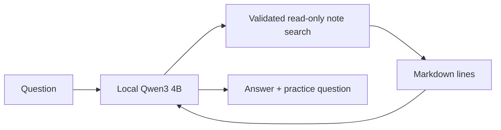

# FL-07 Study Notes AI Assistant

A local study assistant for learners who want a short explanation grounded in their Markdown notes. It uses Python, Ollama with Qwen3 4B, and a localhost-only web interface. It searches the bundled FlyRank data-contract note, answers with source line references, and offers a practice question.

## Requirements

- Python 3.10 or newer
- [Ollama](https://ollama.com/) installed and running
- The local model `qwen3:4b`

## Run the web app

From this folder, pull the model once and start the server:

```bash
ollama pull qwen3:4b
python3 web_app.py
```

Open `http://127.0.0.1:8765` in a browser. The server binds to localhost only. Stop it with Ctrl+C.

## Ask from the command line

```bash
python3 agent.py "Why are zero-filled GA4 fields misleading?"
```

To use other UTF-8 Markdown notes, pass a notes folder with the CLI's `--notes` option. Keep private/client information out of notes used in public demos.

## Architecture



The model may request one read-only note-search tool. Python checks the requested tool name and arguments, searches local Markdown files, and returns bounded matching lines. The model drafts an answer from that context; the interface separately shows the source locations so the reader can verify them. The app has no internet search, file-writing, or note-editing tool.

## Evaluation and checks

Run the seven offline unit tests with controlled model responses:

```bash
python3 -m unittest -v
```

These verify note retrieval, empty evidence, tool restrictions, symlink handling, and source reporting. They are deterministic unit tests, not a benchmark of answer quality. A live Ollama demonstration was recorded separately; the supplied recording is 2 minutes 46 seconds, so it still needs a short extension to meet the assignment's 3–5 minute narrated-demo requirement. No accuracy, learning-gain, or business-impact metric has been measured.

## Limitations and guardrails

- Search is word-based, so paraphrases may need a different question.
- The model can misread retrieved lines or generate an unsupported statement. A citation shows what was retrieved; it does not prove every answer claim.
- Only local Markdown notes are searched; there is no web access or external service call.
- The model makes one or more bounded read-only searches and cannot modify notes.
- The web server is intended for localhost. Do not expose it publicly without authentication and a security review.

## AI assistance transparency

I built this project with AI assistance for implementation, documentation, and test drafting. I reviewed the code, ran the seven offline tests, and recorded a live local run with Ollama. The tests use controlled responses; live model accuracy and prompt-injection resistance have not been comprehensively evaluated.

## Demo

A live local recording is submitted through FlyRank separately and is intentionally not committed here because it is a large video file. The recording needs to be at least 3 minutes and include spoken explanation of one design decision and one limitation before it meets the card criteria.
